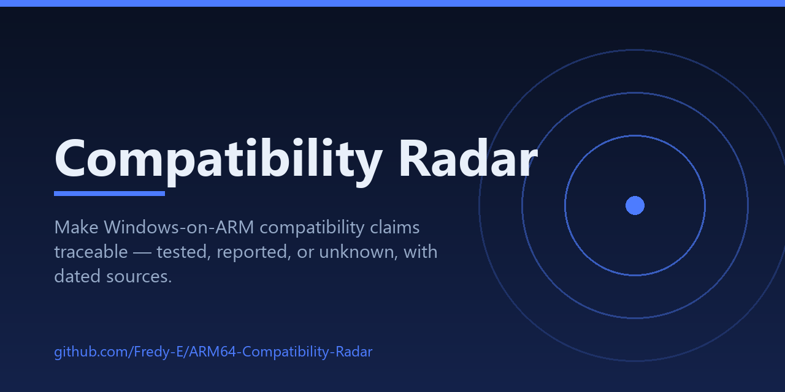
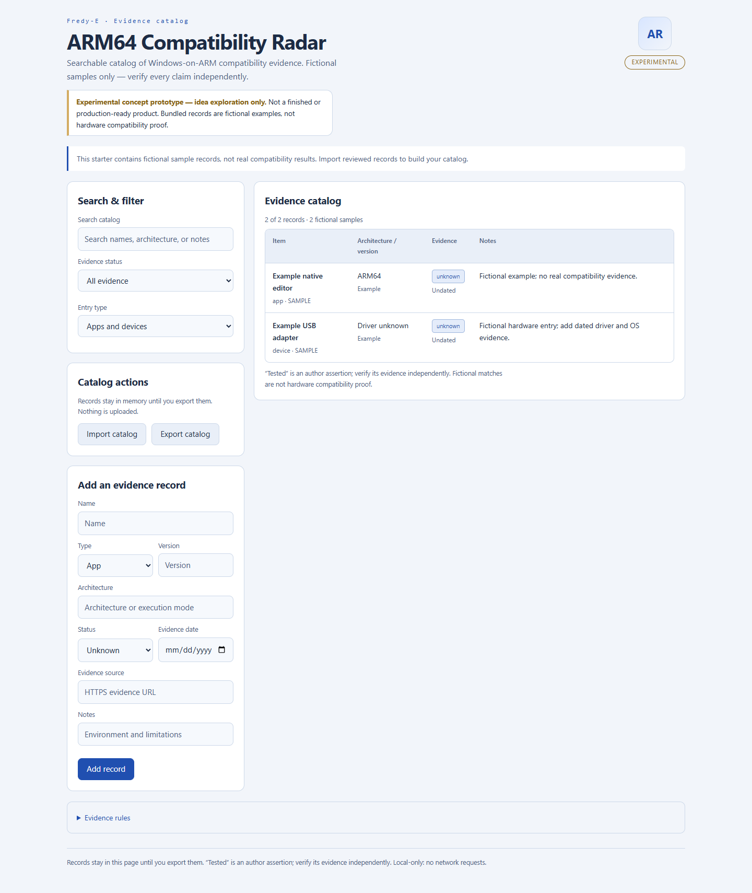

<!-- prototype-status:start -->
> **Experimental concept prototype — idea exploration only.**
> A work-in-progress demo, not a finished or production-ready product. Existing features and tests demonstrate the concept; they do not establish real-world reliability or complete functionality. Features may change or remain unfinished.
<!-- prototype-status:end -->

<p align="center">
  
</p>

<p align="center">
  <a href="https://github.com/Fredy-E/ARM64-Compatibility-Radar/actions/workflows/verify.yml"></a>
  
  
  
  
</p>

## What this is

Open `index.html` in a browser. No installation, no server, no network requests. Search and filter entries, import your own JSON catalog, add dated evidence, and export the result.

- Entry types include apps, drivers, devices, and interfaces.
- `tested` / `reported` records require an HTTPS source and a date.
- The bundled entries are clearly marked **fictional** and `unknown` — they demonstrate the schema, not real compatibility results.
- The app does not establish compatibility itself or verify submitted evidence; changes stay in memory until exported.



## Features

- Search and filter entries by text, evidence status, and entry type.
- Add `unknown`, `reported`, or `tested` records; `tested` / `reported` records are rejected without an HTTPS source and date.
- Import a JSON catalog (up to 5000 records, 10 MB) and export the current catalog as JSON.
- One static page, no runtime dependencies, no network requests; records stay in memory until exported.

## Evidence schema

All values below are **synthetic examples**, not real compatibility results. A record has:

| field | meaning |
| --- | --- |
| `id` | unique record id |
| `name` | app, driver, device, or interface name |
| `type` | `app`, `device`, or another catalog-defined type |
| `architecture` | execution mode, e.g. `ARM64 native`, `x64 emulated` |
| `version` | app/driver version and OS build the claim applies to |
| `status` | `tested`, `reported`, or `unknown` |
| `source` | HTTPS evidence link (required for `tested` / `reported`) |
| `date` | `YYYY-MM-DD` evidence date (required for `tested` / `reported`) |
| `notes` | environment and limitations: device, OS build, execution mode |
| `sample` | `true` for the bundled fictional samples |

```json
[
  {
    "id": "synthetic-example-1",
    "name": "Synthetic example editor",
    "type": "app",
    "architecture": "ARM64 native (synthetic)",
    "version": "Example 1.0 on Windows 11 24H2 (synthetic)",
    "status": "unknown",
    "source": "",
    "date": "",
    "notes": "Synthetic schema example; not a real compatibility result.",
    "sample": false
  },
  {
    "id": "synthetic-example-2",
    "name": "Synthetic example device",
    "type": "device",
    "architecture": "x64 emulated (synthetic)",
    "version": "Example driver 2.1 (synthetic)",
    "status": "reported",
    "source": "https://example.invalid/synthetic-evidence",
    "date": "2026-01-15",
    "notes": "Synthetic schema example with a placeholder HTTPS source.",
    "sample": false
  }
]
```

Contributing reviewed **real** records with independently verifiable evidence remains future work; this prototype ships no real compatibility claims.

## Run

Open `index.html` in a modern browser — no install or server needed. `npm ci` is only required for the test suites.

## Tests

Unit checks (no dependencies):

```sh
node tests/catalog.test.cjs
```

Browser end-to-end checks (Playwright 1.63.0, dev-only):

```sh
npm ci
npm run test:browser
```

The browser checks open the app via `file://` and through a loopback-only static server, assert that no request leaves the local machine, exercise search / add / import / export, and verify the exported bytes (including a re-import round-trip). On dev machines they use the installed Chrome; in CI they use the bundled Playwright Chromium. Override with `PW_CHANNEL=chrome|msedge|bundled`.

CI (badge above) runs both suites on every push. A manual `pages.yml` workflow prepares a static artifact for GitHub Pages; it does not enable or publish Pages by itself.

## Limits

- The bundled records are fictional samples; the app makes no compatibility claim and does not verify evidence.
- `tested` is an author assertion: the app only checks that a source and date are present and that the source uses HTTPS.
- Import validation rejects malformed catalogs and duplicate ids; in-memory changes are lost on reload unless exported.
- No review or contribution workflow exists yet; real records would need independent verification.

## Next

Independently sourced records, stronger environment/version schemas, and a reviewed contribution workflow.

## See also

[DriverLens](https://github.com/Fredy-E/DriverLens) · [MeshLab Mini](https://github.com/Fredy-E/MeshLab-Mini) · [Diagnostic Scan Diff](https://github.com/Fredy-E/Diagnostic-Scan-Diff) · [Offline Museum Kit](https://github.com/Fredy-E/Offline-Museum-Kit) — small local-first tools built for Windows-on-ARM work.

## Verify (default)

Full default verification (unit + static UI shell + real-browser end-to-end):

```sh
npm run verify
# = node tests/catalog.test.cjs && node tests/ui-shell.test.cjs && node tests/browser.cjs
```

`npm test` runs the unit subset only. Browser checks need Playwright 1.63.0 (dev-only) plus Chrome/Chromium; `npm ci` installs dev dependencies with browser download skipped where configured.
